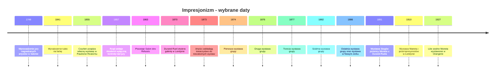

# Impresjonizm w malarstwie

Impresjonizm to kierunek w malarstwie francuskim drugiej połowy XIX wieku, którego twórcy malowali szybko, często w plenerze, i sięgali po tematy z nowoczesnego życia. Ta baza wiedzy zbiera to, co da się sprawdzić w źródłach: muzeach, publikacjach naukowych i encyklopediach. Każdy fakt ma znacznik rzetelności źródła i link, a dowody są w zwijanej ramce na końcu każdej notatki. Gdy źródła się nie zgadzają, pokazujemy obie wersje i niczego nie rozstrzygamy na siłę; gdy czegoś nie udało się ustalić, piszemy o tym wprost.

## Osie
- [[01 - Tło akademizm Salon i poprzednicy|Tło: akademizm, Salon i poprzednicy]] - jak działało jury oficjalnego Salonu i dlaczego odrzucenia popychały artystów ku wystawom poza systemem.
- [[02 - Technika kolor i światło|Technika: kolor, światło i plener]] - ile w obrazach impresjonistów było pracy w plenerze, a ile w pracowni, i co wiadomo o teorii barw.
- [[03 - Technologia i materiały|Technologia i materiały]] - farby w tubkach i fotografia: co o ich wpływie mówią muzea, a co spór wokół tych tez.
- [[04 - Tematy i motywy|Tematy i motywy]] - nowoczesne miasto, czas wolny, praca i życie różnych grup społecznych na obrazach.
- [[05 - Wystawy krytyka nazwa i rynek|Wystawy, krytyka, nazwa ruchu i rynek]] - marszand Durand-Ruel i wystawy za granicą, zwłaszcza w Nowym Jorku w 1886 r.
- [[06 - Dziedzictwo i echo dziś|Dziedzictwo]] - postimpresjonizm, droga do kubizmu i korekta mitu o całkowitym odrzuceniu impresjonistów.

## Artyści
- [[Artysci/Claude Monet|Claude Monet]]
- [[Artysci/Edgar Degas|Edgar Degas]]

## Oś czasu
Daty pochodzą wyłącznie z cytatów zebranych w notatkach.

## Spis ilustracji
Wszystkie obrazy pochodzą z Wikimedia Commons.

| Plik | Tytuł | Autor | Licencja | Strona pliku |
|---|---|---|---|---|
| monet-impresja-wschod-slonca.jpg | Impression, Sunrise | Claude Monet | Public domain | [Commons](https://commons.wikimedia.org/wiki/File:Claude_Monet,_Impression,_soleil_levant.jpg) |
| degas-praczki.jpg | Laundress Carrying Linen | Edgar Degas | CC0 | [Commons](https://commons.wikimedia.org/wiki/File:Edgar_Degas,_Laundress_Carrying_Linen,_c._1885-1895,_NGA_74190.jpg) |
| courbet-pracownia-malarza.jpg | The Painter's Studio | Gustave Courbet | Public domain | [Commons](https://commons.wikimedia.org/wiki/File:Courbet_LAtelier_du_peintre.jpg) |
| seurat-kapiacy-sie-w-asnieres.jpg | Une baignade à Asnières (Bathers at Asnières) | Georges Seurat | Public domain | [Commons](https://commons.wikimedia.org/wiki/File:Baigneurs_a_Asnieres.jpg) |
| monet-dworzec-saint-lazare.jpg | La gare Saint-Lazare | Claude Monet | Public domain | [Commons](https://commons.wikimedia.org/wiki/File:Claude_Monet_-_The_Saint-Lazare_Station_-_Google_Art_Project.jpg) |
| monet-la-grenouillere.jpg | Bathers at La Grenouillère | Claude Monet | Public domain | [Commons](https://commons.wikimedia.org/wiki/File:Claude_Monet_-_Bathers_at_La_Grenouill%C3%A8re.jpg) |
| monet-bulwar-kapucynow.jpg | Le Boulevard des Capucines | Claude Monet | Public domain | [Commons](https://commons.wikimedia.org/wiki/File:Claude_Monet_-_Boulevard_des_Capucines_-_Google_Art_Project.jpg) |
| seurat-niedziela-grande-jatte.jpg | A Sunday on La Grande Jatte -- 1884 | Georges Seurat | Public domain | [Commons](https://commons.wikimedia.org/wiki/File:Georges_Seurat_-_A_Sunday_on_La_Grande_Jatte_--_1884_-_Google_Art_Project.jpg) |

## Jak czytać
- Przy każdym fakcie stoi znacznik rzetelności źródła i link: 🔵 źródło pierwszorzędne (muzeum, archiwum, publikacja naukowa, dokument z epoki), 🟠 źródło drugorzędne (encyklopedia, prasa jakościowa, książka popularnonaukowa), 🔴 źródło słabe (blog, strona bez autora). Fakt oparty tylko na źródle słabym jest zaznaczony jako słaby.
- Dowody są w zwiniętej ramce "Dane źródłowe" na końcu każdej notatki. Aby ją rozwinąć, kliknij jej tytuł. Znajdziesz tam opis faktu, link do źródła, jego poziom i dosłowny cytat.
- Sekcje "Kontrowersje" pokazują, gdzie źródła się różnią; sekcje "Czego nie udało się ustalić" mówią uczciwie, czego w zebranych źródłach brakuje.
